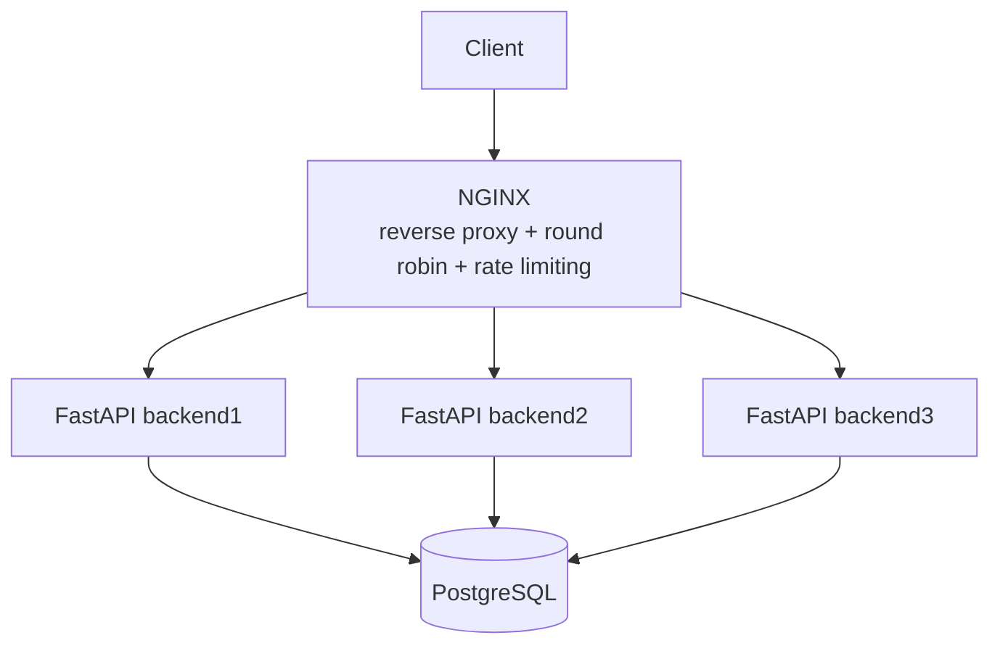

# ScaleURL

A small, production-inspired URL shortening service built with FastAPI,
PostgreSQL, and NGINX. It's intentionally scoped to be something you
can read end-to-end, run locally in a few minutes, and confidently
explain in a technical interview — no unnecessary technologies bolted
on just to look impressive.

## 1. Project Overview

ScaleURL takes a long URL and returns a short one (e.g.
`http://localhost/a8Kx91`) that redirects to the original when
visited. It supports custom aliases, expiration, soft deletion, and
per-link click analytics, and it runs as three identical, stateless
FastAPI instances behind an NGINX load balancer, backed by a single
PostgreSQL database.

The project deliberately avoids Redis, Kafka, Kubernetes, cloud
provider services, and other infrastructure that would be reasonable
in a real large-scale deployment but would obscure the core ideas this
project exists to demonstrate: request routing, statelessness,
database-backed uniqueness, and a clean layered backend.

## 2. Features

- Create a short URL from a long URL
- Redirect a short URL to its original destination
- Custom aliases (`/my-brand`) instead of an auto-generated code
- URL expiration (time-limited links)
- Soft deletion / deactivation of a URL
- Per-URL click counting and last-accessed tracking
- Basic analytics via a stats endpoint
- IP-based rate limiting (separate limits for creation vs. redirects)
- Health check endpoint
- Indexed lookups on the short code
- Fully Dockerized, multi-instance deployment behind NGINX

## 3. Architecture

```
Client
  │
  ▼
NGINX (reverse proxy, round-robin load balancer, IP rate limiter)
  │
  ├──► FastAPI backend1 ──┐
  ├──► FastAPI backend2 ──┼──► PostgreSQL
  └──► FastAPI backend3 ──┘
```

All three FastAPI instances run the exact same code and image. None of
them hold any request-scoped state in memory (no in-process caches,
no sessions) — every request that needs data opens a short-lived
database session, uses it, and closes it. This statelessness is what
makes it safe for NGINX to send any request to any of the three
instances, and what would make it safe to add a fourth or fifth
instance later without changing any code.

## 4. Architecture Diagram (Mermaid)



## 5. Technology Stack

| Layer          | Technology                          |
|----------------|--------------------------------------|
| Language       | Python 3.12+                         |
| Web framework  | FastAPI                              |
| Validation     | Pydantic v2                          |
| ORM            | SQLAlchemy 2.0                       |
| DB driver      | psycopg (v3)                         |
| Migrations     | Alembic                              |
| Database       | PostgreSQL 16                        |
| Reverse proxy  | NGINX                                |
| Containers     | Docker, Docker Compose               |
| Testing        | pytest, FastAPI `TestClient`         |

No Redis, Kafka, Celery, Kubernetes, cloud SDKs, JWT/OAuth, or
microservices — see [Section 17](#17-scalability-discussion) for why
and what would change if this needed to scale further.

## 6. Database Schema

Single table, `urls`:

| Column            | Type                      | Notes                                  |
|-------------------|---------------------------|-----------------------------------------|
| `id`              | `BIGSERIAL PRIMARY KEY`   | Source of the Base62-encoded short code |
| `short_code`      | `VARCHAR(20) UNIQUE`      | Indexed; what clients see in the URL    |
| `long_url`        | `TEXT`                    | Original destination                    |
| `custom_alias`    | `BOOLEAN`                 | True if the code was user-chosen        |
| `created_at`      | `TIMESTAMPTZ`             | Defaults to now()                       |
| `expires_at`      | `TIMESTAMPTZ`, nullable   | Null = never expires                    |
| `click_count`     | `BIGINT`                  | Incremented on every successful redirect|
| `last_accessed_at`| `TIMESTAMPTZ`, nullable   | Updated on every successful redirect    |
| `is_active`       | `BOOLEAN`                 | False after deletion (soft delete)      |

A unique index on `short_code` (`ix_urls_short_code`) serves two
purposes at once: it enforces that no two rows can share a short code,
and it makes the redirect endpoint's lookup — the highest-traffic
query in the whole system — an index lookup instead of a table scan.

## 7. API Documentation

### `POST /api/v1/urls` — create a short URL

Request:
```json
{
  "long_url": "https://example.com",
  "custom_alias": null,
  "expires_in_hours": 24
}
```

Response `201 Created`:
```json
{
  "short_code": "a8Kx91",
  "short_url": "http://localhost/a8Kx91",
  "long_url": "https://example.com/",
  "expires_at": "2026-01-02T12:00:00Z",
  "created_at": "2026-01-01T12:00:00Z"
}
```

Errors: `400` (reserved alias), `409` (alias already taken), `422`
(invalid URL / bad payload).

### `GET /{short_code}` — redirect

- `302 Found` with `Location` set to the original URL on success.
- `404 Not Found` if the short code doesn't exist.
- `410 Gone` if it exists but has expired or been deactivated.

### `GET /api/v1/urls/{short_code}/stats` — analytics

Response `200 OK`:
```json
{
  "short_code": "a8Kx91",
  "long_url": "https://example.com/",
  "total_clicks": 42,
  "created_at": "2026-01-01T12:00:00Z",
  "last_accessed_at": "2026-01-01T18:30:00Z",
  "expires_at": "2026-01-02T12:00:00Z",
  "is_active": true
}
```

Stats remain viewable even after a URL has expired or been
deactivated — only `GET /{short_code}` itself enforces the 410.

### `DELETE /api/v1/urls/{short_code}` — deactivate

Soft-deletes the URL (`is_active = false`). The row and its click
history are kept. Returns `200 OK` with a confirmation message, or
`404` if the code doesn't exist.

### `GET /health` — health check

Returns `{"status": "healthy"}`. Doesn't touch the database, so it
stays fast and cheap for Docker or a load balancer to poll frequently.

## 8. Base62 Explanation

Rather than generating a random string and hoping it doesn't collide
(and re-rolling if it does), ScaleURL leans on PostgreSQL itself:
`id` is a `BIGSERIAL`, so the database already guarantees every row
gets a unique, sequential integer. `encode()` converts that integer
into a short string using a 62-character alphabet
(`0-9`, `a-z`, `A-Z`), the same idea as converting a number to
hexadecimal but with 62 symbols instead of 16. `decode()` reverses it.

```
encode(0)   -> "0"
encode(61)  -> "Z"
encode(62)  -> "10"     (one full "rotation" of the alphabet)
```

Because the mapping is a pure function of the ID, there's no
collision to check for and no random-generation retry loop — two
different IDs can never encode to the same string, and the same ID
always encodes to the same string. This is also why custom aliases
are tracked with a separate `custom_alias` boolean: they don't come
from this scheme at all, they're stored as literal short codes and
checked for uniqueness directly against the table.

## 9. Rate Limiting Explanation

NGINX enforces IP-based rate limiting using `limit_req_zone`, keyed on
the client's address (`$binary_remote_addr`). Two independent zones
are defined:

- `creation_limit`: 5 requests/second per IP, applied to
  `/api/v1/urls` (creating new links) — deliberately tighter, since
  creation is rarer and cheaper for an abuser to spam.
- `redirect_limit`: 20 requests/second per IP, applied to everything
  else, including the `/{short_code}` redirect path — this is the
  expected high-volume path for real traffic.

Each zone allows a small burst (`burst=10` / `burst=40`) so a
legitimate user firing off a handful of requests in quick succession
doesn't get penalized, but sustained abuse past the limit gets an
immediate `429 Too Many Requests` (`nodelay` means excess requests are
rejected outright instead of being queued and delayed).

## 10. NGINX Load Balancing Explanation

The `upstream backend { ... }` block lists all three FastAPI
containers by their Docker Compose service name
(`backend1:8000`, `backend2:8000`, `backend3:8000`). NGINX's default
load-balancing algorithm for an `upstream` block with no algorithm
directive is round-robin: each new request is sent to the next server
in the list, cycling back to the first after the third. Combined with
`proxy_next_upstream`, if one backend fails to respond (connection
error, timeout, or a 502/503/504), NGINX automatically retries the
request against the next upstream server rather than failing the
client's request outright.

## 11. Stateless Backend Explanation

"Stateless" here specifically means: no backend instance keeps
anything in process memory that a later request depends on. There's
no in-memory cache of URLs, no session storage, no counters held in a
Python variable. Every read and write goes straight to PostgreSQL
inside the same request that needs it. The practical consequence is
that NGINX can route any request to any of the three instances in any
order, any instance can be restarted or replaced without losing data,
and adding a fourth instance is just adding another line to
`nginx.conf`'s `upstream` block and another service in
`docker-compose.yml` — no code changes required.

## 12. Docker Setup

```bash
git clone <this-repo>
cd scaleurl
cp .env.example .env   # optional, only used outside Docker
docker compose up --build
```

This builds the FastAPI image once and starts:
- `postgres` — the database (with a health check gating startup)
- `migrate` — a one-shot container that runs `alembic upgrade head`
  and exits (backends wait for this to finish successfully)
- `backend1`, `backend2`, `backend3` — three identical API instances
- `nginx` — reverse proxy on port 80

Once it's up, the app is reachable at `http://localhost/`.

## 13. Local Development Setup (without Docker)

```bash
python3 -m venv .venv
source .venv/bin/activate
pip install -r requirements.txt

# Start a local PostgreSQL and set DATABASE_URL accordingly, then:
alembic upgrade head
uvicorn app.main:app --reload
```

## 14. Testing

```bash
pip install -r requirements.txt
pytest -v
```

Tests run against an in-memory SQLite database via dependency
overrides (see `tests/conftest.py`), so they don't require Docker or a
running Postgres instance. Coverage includes:

- Base62 encode/decode, including round trips and edge cases (0, 61,
  62, large numbers, invalid input)
- URL creation: valid URL, invalid URL, custom alias, duplicate alias,
  reserved alias, expiration
- Redirects: valid code, unknown code (404), expired code (410),
  deactivated code (410)
- Stats: click count and `last_accessed_at` update correctly after
  redirects, unknown code returns 404
- Deletion: deactivation works and is reflected in stats, unknown code
  returns 404

## 15. Example curl Commands

Create a short URL:
```bash
curl -X POST http://localhost/api/v1/urls \
  -H "Content-Type: application/json" \
  -d '{"long_url": "https://example.com", "expires_in_hours": 24}'
```

Create one with a custom alias:
```bash
curl -X POST http://localhost/api/v1/urls \
  -H "Content-Type: application/json" \
  -d '{"long_url": "https://example.com/pricing", "custom_alias": "pricing"}'
```

Follow a short URL:
```bash
curl -i http://localhost/a8Kx91
```

Get stats:
```bash
curl http://localhost/api/v1/urls/a8Kx91/stats
```

Deactivate a URL:
```bash
curl -X DELETE http://localhost/api/v1/urls/a8Kx91
```

Health check:
```bash
curl http://localhost/health
```

## 16. Failure Scenarios

1. **One FastAPI instance goes down.** NGINX's `proxy_next_upstream`
   detects the connection failure/timeout and retries the request
   against one of the remaining two instances. The client sees a
   successful response, not an error, as long as at least one backend
   is healthy.
2. **Multiple requests arrive simultaneously.** Each request gets its
   own database session and transaction. Two simultaneous creates with
   different data never conflict. Two simultaneous creates racing for
   the *same* custom alias are resolved by PostgreSQL's unique index
   on `short_code`: whichever transaction commits first wins, and the
   second gets a uniqueness violation, which the service layer surfaces
   as a `409 Conflict`.
3. **Database is unavailable.** Every backend instance fails its
   queries and returns a `500`-level error to NGINX; NGINX's
   `proxy_next_upstream` won't help here since *all* backends depend on
   the same database. This is the single point of failure in this
   design — see [Scalability Discussion](#17-scalability-discussion)
   for how read replicas would mitigate (not eliminate) this.
4. **A client exceeds rate limits.** NGINX itself returns `429 Too
   Many Requests` before the request ever reaches a FastAPI instance.
5. **A custom alias already exists.** The service layer checks for an
   existing row with that `short_code` before inserting and raises a
   domain error that the router turns into `409 Conflict`. The unique
   index is a second line of defense against a race between the check
   and the insert.
6. **A URL has expired.** `GET /{short_code}` compares `expires_at`
   against the current time and returns `410 Gone` instead of
   redirecting, distinguishing "this never existed" (`404`) from "this
   existed but is no longer valid" (`410`).

## 17. Scalability Discussion

What's implemented today is deliberately minimal. If ScaleURL needed
to handle real production load, these are the next steps — described
conceptually only; **none of the following are implemented in this
repository**:

- **Redis/cache layer**: Redirects are by far the highest-traffic
  endpoint and are read-heavy. A cache (e.g. short_code → long_url) in
  front of PostgreSQL would remove the database from the hot path for
  most requests, at the cost of needing a cache-invalidation strategy
  for deactivation/expiration.
- **PostgreSQL read replicas**: Since redirects only read data, they
  could be served from one or more read replicas, leaving the primary
  free to handle writes (creations, click updates). This would also
  reduce (though not eliminate) the "database unavailable" single
  point of failure described above.
- **CDN**: For a public-facing shortener, a CDN could cache redirect
  responses geographically closer to users, further cutting latency
  and origin load for popular links.
- **Asynchronous analytics/event queue**: Updating `click_count` and
  `last_accessed_at` synchronously on every redirect adds a write to
  the critical path of the highest-traffic endpoint. A message queue
  (e.g. publish a "click" event and process it asynchronously) would
  let the redirect itself return immediately while click accounting
  happens in the background, and would also open the door to richer
  analytics (referrers, geography, timestamps per click) without
  slowing down redirects.

## 18. Future Improvements

- Structured request logging / correlation IDs across the three
  backend instances
- Per-alias custom expiration policies (e.g. auto-expire after N
  clicks)
- Bulk URL creation endpoint
- Admin-facing endpoint to list/search all URLs (currently only
  single-URL lookups exist)
- API-level authentication for the creation/deletion endpoints (not
  implemented here to keep the scope focused, since the assignment
  explicitly excludes JWT/OAuth)

## License

MIT — see [LICENSE](LICENSE).
